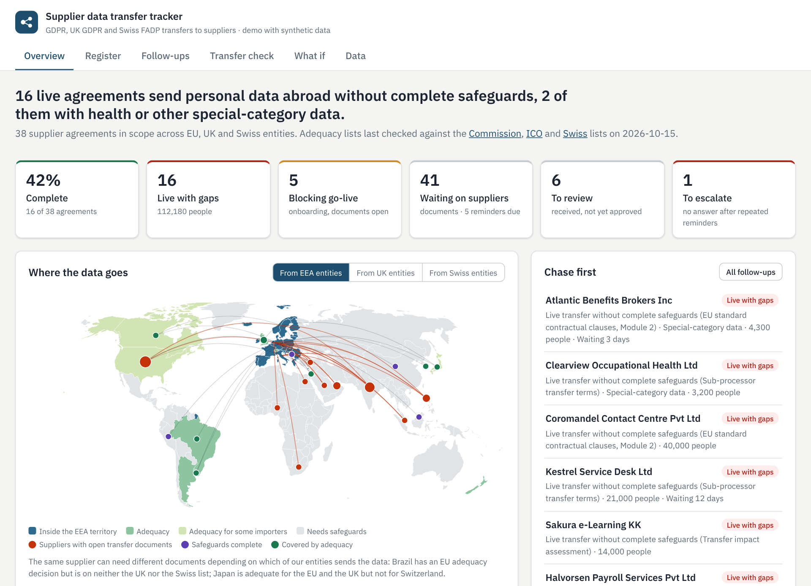
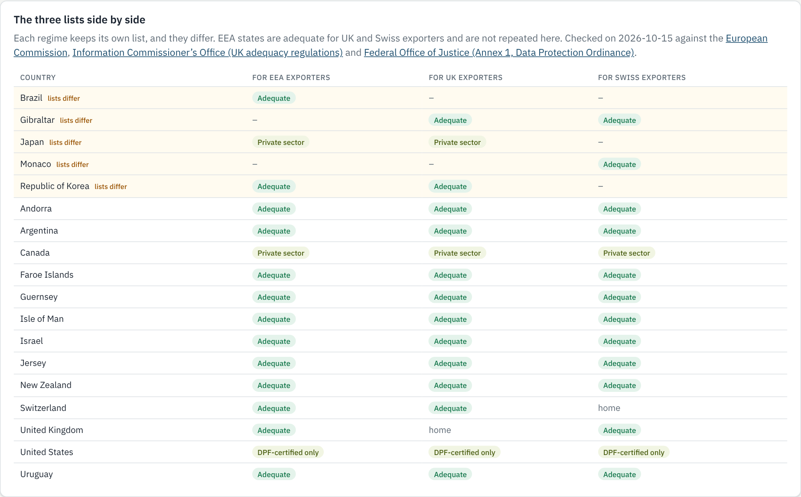
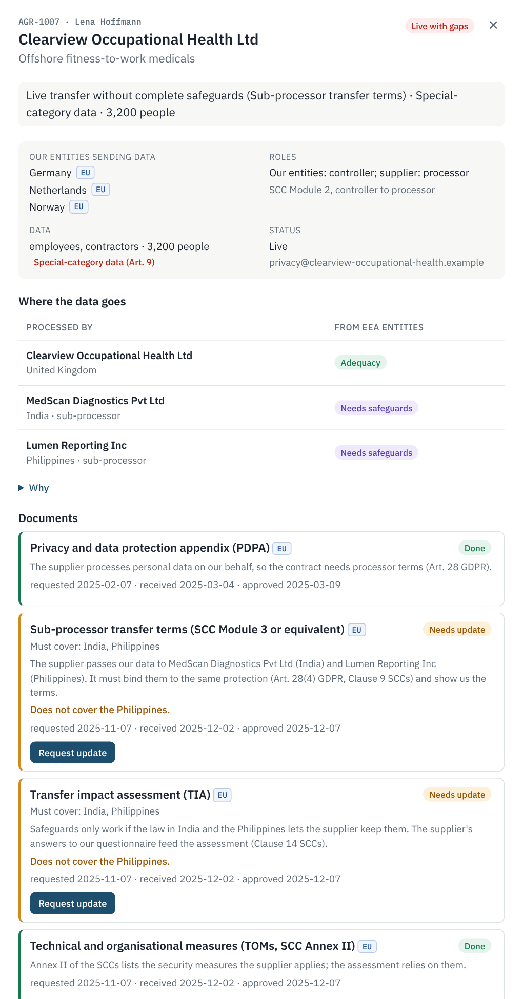
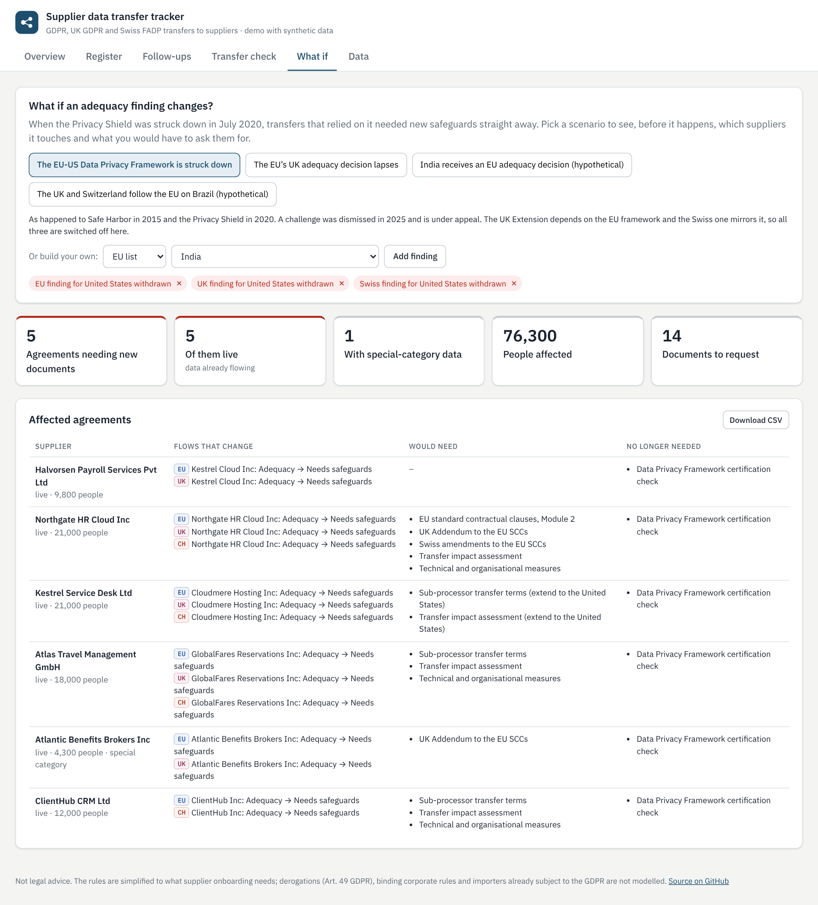

# Supplier data transfer tracker

**Live demo:** https://awaisq5.github.io/supplier-data-transfer-tracker/

When a supplier outside Europe handles employee or customer data, signing the contract is not enough. Depending on which of your entities sends the data and where the supplier (and its sub-processors) handle it, the transfer may need standard contractual clauses in the right module, UK or Swiss add-ons, a transfer impact assessment and the supplier's security measures. Then someone has to collect all of it, supplier by supplier.

This tool works out what each supplier agreement needs under EU, UK and Swiss rules, tracks every document from request to approval, drafts the reminder emails, and puts the suppliers to chase first at the top.



## Where this comes from

In a global commodity rotation in procurement, part of my work was data protection on the supplier side: executing privacy and data protection appendices (PDPAs) and standard contractual clauses for transfers of personal data from the EEA, the UK and Switzerland to restricted countries, following up with my assigned suppliers to return transfer impact assessments together with their technical and organisational measures, and working out where region-specific clauses were needed.

That work ran on spreadsheets and email. This project is the tool I would have wanted for it: rules that decide what each supplier needs, so every follow-up asks for the right documents, and a register that shows at a glance where personal data flows without safeguards. **All data here is synthetic**: the company, its entities and every supplier are invented, and contact addresses use the reserved `.example` domain.

> **Independent personal project.** I built this on my own time, after my employment ended, to show the kind of work I did professionally. It contains no code, data, documents, screenshots or other information belonging to any former employer, its customers or its suppliers. The method is rebuilt from general professional knowledge, all data in the repository is synthetic, and the only figures quoted from my career are the ones published on my CV.

## What it does

**1. Works out the transfer tool for every flow.** A flow is one exporting regime (from the countries of our entities that send data) to one place where the supplier or a sub-processor handles it. Each flow is one of:

| Outcome | When | What it needs |
|---|---|---|
| No transfer | Destination inside the regime's own territory | Processor terms only |
| Adequacy | Destination on that regime's list, conditions met | Processor terms; for US importers, a check of the DPF listing |
| Needs safeguards | No adequacy, or a condition fails | SCCs in the module that matches the roles, plus UK or Swiss add-ons, a transfer impact assessment and TOMs |
| Supplier's own transfer | The supplier is a controller and passes data on | Nothing from us: its onward transfers are its own responsibility |

The Transfer check tab gives the same answer for a single supplier before it is in the register.

**2. Applies each regime's own list.** The EU, the UK and Switzerland keep separate adequacy lists, and they differ: Brazil is adequate for the EU only (since January 2026), Japan for the EU and the UK but not Switzerland, Monaco for Switzerland only. Canada and Japan are covered only for private-sector importers, and the US only for importers certified under the matching Data Privacy Framework, with HR coverage if the data is about the workforce. The lists live in [`src/law/adequacy.ts`](src/law/adequacy.ts) as data, each with its source and the date it was last checked.



**3. Follows the data to sub-processors.** A supplier in Ireland is not the end of the story if its service desk runs from India and the Philippines. Sub-processors in restricted countries need flow-down terms, and the assessment has to cover their countries too.

**4. Tracks documents and notices when they go out of date.** Each document moves from requested to received to approved, with reminders logged. An approved assessment that does not cover a country added since (a new sub-processor, say), SCCs signed under the wrong module, and DPF checks older than a year all reopen as "needs update".



**5. Puts the most important follow-ups first, for reasons you can say in one sentence.** Live agreements with gaps come before onboarding, which comes before housekeeping. Within a group: missing transfer safeguards before other paperwork, then special-category data, then the number of people, then how long the supplier has been waiting. No weighted score to argue about.

**6. Drafts the email.** The request or reminder lists exactly what this supplier still owes, with the countries each assessment must cover, and numbers the reminders. After three reminders without an answer the agreement is flagged for escalation.

**7. Answers "what if a decision changes?"** When the Privacy Shield was struck down in 2020, every company had to find out overnight which suppliers relied on it. The What if view switches any adequacy finding off or on and shows the affected agreements, the documents to request and those no longer needed. Presets include the EU-US Data Privacy Framework falling (a challenge is under appeal at the Court of Justice). The same comparison previews the effect of an edit, such as a supplier announcing a new sub-processor, before you save it.



**8. Reads the register you already have.** Import a CSV exported from a spreadsheet: one row per processing location, country names or ISO codes, ISO or German dates. Problems are reported by row before anything is replaced. Export to CSV, or keep a full JSON backup.

## Running it

```bash
npm ci
npm run dev        # http://localhost:5173
npm test           # 46 tests on the rules, follow-up logic, CSV import and what-if
npm run build
```

The app runs entirely in the browser and keeps the register in local storage; nothing is sent anywhere.

## Project structure

```
src/law/regimes.ts        EEA territory, regimes, fine ceilings
src/law/adequacy.ts       adequacy lists with sources, the timeline of changes
src/domain/rules.ts       flows per regime and destination, documents each agreement needs
src/domain/documents.ts   document status, reminders, escalation, priority, email drafts
src/domain/actions.ts     request, remind, receive, approve, send back
src/domain/whatif.ts      list changes and edits compared before and after
src/domain/csv.ts         register import with validation, export, template
src/data/sample.ts        synthetic register, dated relative to today
src/pages/                overview, register, follow-ups, transfer check, what if, data
```

## Limits

- **Not legal advice.** The rules cover what supplier onboarding needs. Derogations (Art. 49 GDPR), binding corporate rules, and importers already subject to the GDPR under Art. 3(2), for which the SCCs are not designed, are out of scope.
- The tool tracks that an assessment exists and covers the right countries. It does not assess the destination's laws itself.
- UK transfers follow the Data (Use and Access) Act test since 5 February 2026; the tool keeps the IDTA and the UK Addendum as the UK tools.
- Adequacy lists change. They were checked against the Commission, ICO and Swiss Federal Office of Justice pages on the date in `adequacy.ts`, and need re-checking before relying on them.
- One user per browser. A team version would need a backend with users and an audit trail.

## License

MIT
